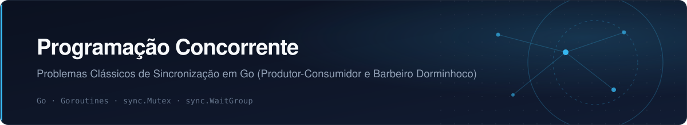

<p align="center">
  
</p>

<p align="center">
  
  
</p>

## Sobre o Projeto

Coleção de exercícios de **Programação Concorrente** em **Go**, explorando sincronização entre *goroutines*, exclusão mútua com `sync.Mutex`, coordenação com `sync.WaitGroup` e cedência cooperativa com `runtime.Gosched()`.

## Exercícios Implementados

| Caminho | Problema | Mecanismos Utilizados |
| :--- | :--- | :--- |
| `Exercício 02/Questão 01/main/main.go` | **Produtor-Consumidor** com `MutexEventBuffer` | `sync.Mutex`, `sync.WaitGroup`, `runtime.Gosched()` |
| `Exercício 02/Questão 02/main.go` | **Barbeiro Dorminhoco** (`cliente` / `barbeiro` + buffer limitado) | `sync.Mutex`, `sync.WaitGroup`, `runtime.Gosched()` |

## Como Executar

Com o [Go](https://go.dev/dl/) instalado:

```bash
# Clone o repositório
git clone https://github.com/charles-gabriel-cc/Concorrente.git
cd Concorrente

# Executar Questão 01 (Produtor-Consumidor)
go run "Exercício 02/Questão 01/main/main.go"

# Executar Questão 02 (Barbeiro Dorminhoco)
go run "Exercício 02/Questão 02/main.go"
```

---

<div align="center">
  <sub>Desenvolvido por <a href="https://github.com/charles-gabriel-cc">Charles Gabriel</a></sub>
</div>
